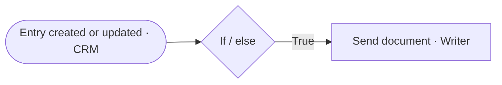

# FlowOps 3 — Quote and Sign

> When a CRM record is created or updated and meets the condition, the quote or document goes out automatically.

**Live case study:** [https://mnkiswan.github.io/flowops-3-quote-and-sign/](https://mnkiswan.github.io/flowops-3-quote-and-sign/) · **Portfolio:** [zoho-flow-portfolio](https://mnkiswan.github.io/zoho-flow-portfolio/)

**Trigger:** A CRM entry is created or updated  
**Zoho apps:** Zoho CRM, Zoho Writer

## Flow

## Steps

1. **A CRM entry is created or updated** (Zoho CRM): The trigger fires on every create or update, so the flow sees the record in its latest state.
2. **Check the condition** (If / else): Only records that meet the condition continue. Everything else stops here, so documents aren't sent by mistake.
3. **Send the document** (Zoho Writer): When the condition is true, the Writer document is sent without anyone preparing it by hand.

## The problem

A deal could reach the right stage and then sit while someone prepared and sent the quote. Deals stalled on admin, not on the customer.

## Business impact

- **Documents go out**: The quote or document is sent the moment the deal reaches the condition.
- **Stalled deals**: The next step happens on its own, so the pipeline keeps moving.
- **Wording every time**: Every document comes from the same Writer template.

---
Part of the [Zoho Flow portfolio](https://github.com/mnkiswan/zoho-flow-portfolio).
